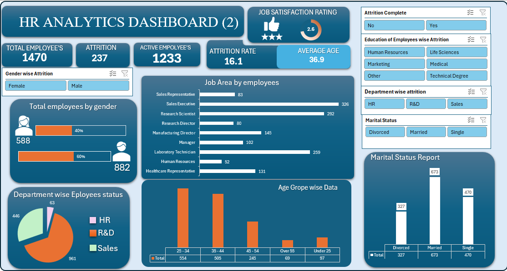
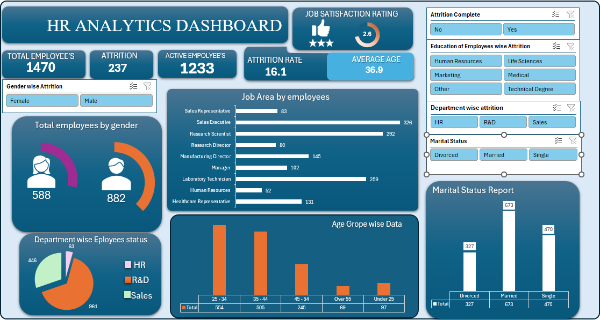

<div align="center">

# 📊 HR ANALYTICS DASHBOARD

### Turning Workforce Data into Actionable HR Insights

**An interactive Excel dashboard for employee attrition, workforce distribution, demographics and HR reporting.**

<p>
  
  
  
  
</p>

<p>
  <a href="https://github.com/heyrohhit">
    
  </a>
</p>

</div>

---

## 📑 Table of Contents

- [About the Project](#-about-the-project)
- [Dashboard Preview](#-dashboard-preview)
- [Business Problem](#-business-problem)
- [Project Objectives](#-project-objectives)
- [Key Performance Indicators](#-key-performance-indicators)
- [Dashboard Features](#-dashboard-features)
- [Charts and Visualizations](#-charts-and-visualizations)
- [Interactive Filters](#-interactive-filters)
- [Key Observations](#-key-observations)
- [Tools and Skills](#-tools-and-skills)
- [Dataset Overview](#-dataset-overview)
- [How to Use the Dashboard](#-how-to-use-the-dashboard)
- [How to Recreate the Project](#-how-to-recreate-the-project)
- [Repository Structure](#-repository-structure)
- [Future Improvements](#-future-improvements)
- [Data Privacy and Limitations](#-data-privacy-and-limitations)
- [Author](#-author)

---

## 📌 About the Project

The **HR Analytics Dashboard** is an Excel-based data visualization project designed to present workforce information in a clear, interactive and business-friendly format.

Human Resources teams work with employee records, department information, job roles, demographic details and attrition data. Analyzing this information manually can make it difficult to identify patterns and compare different employee groups.

This dashboard brings important HR metrics and visualizations together in a single view.

It helps users explore:

- 👥 Total employee headcount
- 🚪 Employee attrition
- 🟢 Active employee count
- 📉 Overall attrition rate
- 🎂 Average employee age
- 🧑‍🤝‍🧑 Gender distribution
- 🏢 Department-wise employee distribution
- 💼 Employee distribution by job role
- 📊 Age-group distribution
- 💍 Marital status distribution
- 🎓 Education categories
- 🔎 Workforce segments using interactive slicers

The project demonstrates how Excel can be used to transform employee data into an informative HR dashboard.

> **Project type:** HR Analytics | Microsoft Excel | Dashboard Development | Data Visualization

---

## 🖼️ Dashboard Preview

### 1. Main HR Analytics Dashboard

The main dashboard combines KPI cards, workforce charts, department distribution and interactive filters to provide a high-level overview of the employee dataset.

<div align="center">



<p><em>Figure 1: HR Analytics Dashboard — primary dashboard view.</em></p>

</div>

### 2. Dashboard Layout and Visualization View

The second screenshot presents another view of the dashboard layout, including KPI cards, gender distribution, job role analysis, age groups and marital status.

<div align="center">



<p><em>Figure 2: HR Analytics Dashboard — alternate layout view.</em></p>

</div>

**Image display requirements**

The screenshots must be uploaded to the repository with the exact filenames shown below:

- `assets/hr-analytics-dashboard.png`
- `assets/hr-analytics-dashboard-layout.png`

The image paths are relative to the location of this README file. Keep the filenames and folder names consistent.

---

## 🎯 Business Problem

Organizations need to understand their workforce composition and employee attrition to support effective HR planning.

However, raw employee records do not always provide an immediate overview of important workforce metrics.

Without a consolidated report, HR professionals may find it difficult to:

- Monitor employee headcount and attrition.
- Compare workforce distribution across departments.
- Understand employee demographics.
- Identify job roles with different employee counts.
- Explore how attrition varies across employee categories.
- Filter information without repeatedly creating separate reports.

### Project Solution

This dashboard organizes the available HR data into KPI cards, charts and interactive slicers.

It enables users to explore the workforce from multiple perspectives and review relevant metrics more efficiently.

---

## 🎯 Project Objectives

The primary objectives of this project are:

1. **Workforce monitoring:** Display total, active and departed employee counts.
2. **Attrition analysis:** Present the overall attrition rate and allow exploration by employee category.
3. **Demographic analysis:** Compare workforce distribution by gender, age group and marital status.
4. **Department analysis:** Visualize the employee distribution across departments.
5. **Job role analysis:** Compare employee counts across different job roles.
6. **Interactive reporting:** Use slicers to filter connected dashboard components.
7. **Data storytelling:** Arrange important metrics and charts in a clear visual hierarchy.
8. **Excel skill development:** Demonstrate practical dashboard design and data summarization techniques.

---

## 📈 Key Performance Indicators

The following KPI values are displayed in the supplied dashboard screenshots.

| KPI | Value | Description |
|---|---:|---|
| Total Employees | 1,470 | Total employee records represented |
| Attrition | 237 | Employees recorded as having left |
| Active Employees | 1,233 | Employees remaining active |
| Attrition Rate | 16.1% | Displayed proportion of employees who left |
| Average Age | 36.9 | Average employee age displayed |
| Job Satisfaction Rating | 2.6 | Displayed average job satisfaction rating |

### KPI Interpretation

**Total Employees — 1,470**

Represents the total workforce count shown in the dashboard.

**Attrition — 237**

Represents the number of employees recorded as having left the organization.

**Active Employees — 1,233**

Represents the number of employees remaining active in the dataset.

**Attrition Rate — 16.1%**

The displayed rate can be interpreted as the percentage of employees who left relative to the total employee count.

Formula:

`Attrition Rate = (Employees Who Left / Total Employees) × 100`

Using the displayed counts:

`(237 / 1470) × 100 ≈ 16.12%`

Rounded to one decimal place, this is **16.1%**.

**Average Age — 36.9**

Represents the average age displayed in the dashboard.

**Job Satisfaction Rating — 2.6**

Represents the average rating displayed by the dashboard. The rating scale and calculation should be confirmed from the source workbook before drawing conclusions.

> **Important:** The KPI values are transcribed from the supplied screenshots. They should be validated against the source workbook before being used in formal business reporting.

---

## 📊 Dashboard Features

### 1. KPI Summary Cards

The top section presents key workforce indicators.

- Total Employees
- Attrition
- Active Employees
- Attrition Rate
- Average Age
- Job Satisfaction Rating

These cards allow viewers to understand the overall workforce position before exploring individual charts.

### 2. Gender Analysis

The gender visualization displays the employee counts for female and male employees.

Displayed counts:

- Female: 588
- Male: 882

The chart provides a quick comparison of workforce distribution by gender.

### 3. Department-Wise Employee Distribution

The department visualization displays the employee distribution across three departments.

Displayed categories:

- HR
- R&D
- Sales

The chart helps users compare the relative size of each department.

### 4. Job Role Analysis

The horizontal bar chart compares employee counts across multiple job roles.

Displayed job roles include:

- Sales Representative
- Sales Executive
- Research Scientist
- Research Director
- Manufacturing Director
- Manager
- Laboratory Technician
- Human Resources
- Healthcare Representative

The chart makes it easier to compare roles with larger and smaller employee counts.

### 5. Age Group Analysis

The age-group chart presents the distribution of employees across age brackets.

Displayed categories:

- Under 25
- 25–34
- 35–44
- 45–54
- Over 55

This visualization supports demographic comparisons across different age groups.

### 6. Marital Status Analysis

The marital status chart displays employee counts for three categories.

| Marital Status | Displayed Count |
|---|---:|
| Divorced | 327 |
| Married | 673 |
| Single | 470 |

This chart provides a quick overview of the marital status distribution in the displayed dataset.

### 7. Interactive Slicers

The dashboard includes slicers for filtering selected employee categories.

Available slicer groups shown in the screenshots include:

- Gender
- Attrition status
- Education category
- Department
- Marital status

Slicer selections can help users explore relevant employee groups without manually editing the underlying records.

---

## 📉 Charts and Visualizations

| Visualization | Chart Type | Analytical Purpose |
|---|---|---|
| Gender Distribution | Icon / segment-style visualization | Compare employee counts by gender |
| Department Distribution | Pie Chart | Compare department-level employee counts |
| Job Role Analysis | Horizontal Bar Chart | Compare employee counts by job role |
| Age Group Analysis | Column Chart | Compare employee counts across age brackets |
| Marital Status Analysis | Column Chart | Compare employee counts by marital status |
| KPI Summary | KPI Cards | Highlight major workforce metrics |

### Why These Charts?

**Horizontal bar charts**

Useful for comparing multiple job roles with readable category labels.

**Pie charts**

Useful for showing the relative distribution of a small number of categories.

**Column charts**

Useful for comparing employee counts across age groups and marital status categories.

**KPI cards**

Useful for presenting important figures prominently.

**Slicers**

Useful for interactive filtering when connected to the relevant PivotTables or other supported Excel data objects.

---

## 🎛️ Interactive Filters

The dashboard contains slicers that allow users to explore different employee segments.

### Attrition Status

Filter the dashboard by:

- Yes
- No

This helps compare employees recorded as having left with those who remain active.

### Education Category

The visible slicer categories include:

- Human Resources
- Life Sciences
- Marketing
- Medical
- Other
- Technical Degree

These categories can be used to explore the employee groups represented in the workbook.

### Department

The visible department options include:

- HR
- R&D
- Sales

This filter supports department-level workforce comparisons.

### Marital Status

The available categories are:

- Divorced
- Married
- Single

This filter helps explore the dashboard by marital status.

### Gender

The gender slicer displays:

- Female
- Male

This allows users to explore gender-related workforce information.

### How to Use the Slicers

1. Open the Excel workbook.
2. Click a category in the desired slicer.
3. Review the charts and KPI values connected to that slicer.
4. Select another category to compare the results.
5. Use the slicer's clear-filter icon to remove its selection.
6. If a chart does not respond, inspect its PivotTable or Report Connections.

> A slicer only filters the Excel objects to which it is connected. The exact filtering behavior depends on the workbook configuration.

---

## 🔍 Key Observations

The displayed dashboard values allow the following descriptive observations.

### Workforce Size

The dashboard represents 1,470 employee records, of which 1,233 are shown as active and 237 are recorded as attrition.

### Attrition Rate

The displayed attrition rate is approximately 16.1%, based on the displayed attrition count and total workforce.

### Gender Distribution

The dashboard shows 882 male employees and 588 female employees.

### Department Distribution

The department chart shows HR, R&D and Sales as the displayed department categories. R&D has the largest displayed count among these categories.

### Job Role Distribution

The job role chart allows viewers to compare employee counts across different roles and identify the roles with relatively higher or lower representation.

### Age Groups

The age-group chart enables comparisons across five age brackets and supports further demographic exploration.

### Marital Status

The displayed marital status counts are:

- Married: 673
- Single: 470
- Divorced: 327

Married employees represent the largest of these three displayed categories.

> These are descriptive observations from the dashboard, not evidence that a demographic category or job role causes employee attrition. Further analysis would be needed to investigate possible relationships.

---

## 🛠️ Tools and Skills

### Tools

- Microsoft Excel
- Excel charts and dashboard layouts
- Excel slicers
- PivotTables and summarized data, where implemented
- KPI cards and formatted report elements

### Technical Skills Demonstrated

- Data organization and summarization
- HR metrics reporting
- Chart selection and visual presentation
- Dashboard layout and formatting
- Interactive filtering
- Workforce distribution analysis
- Attrition rate calculation
- Data interpretation and reporting

### Business Skills Demonstrated

- Converting raw data into visual information
- Presenting key performance indicators
- Structuring reports around business questions
- Comparing employee categories
- Communicating findings clearly

**Implementation note:** The screenshots demonstrate the dashboard's visible components. Confirm the exact formulas, PivotTables, chart types and connections in the workbook before describing every element as a verified technical implementation.

---

## 🗂️ Dataset Overview

The dashboard displays information related to the following categories.

| Data Category | Example Fields / Values |
|---|---|
| Workforce Summary | Total Employees, Active Employees, Attrition |
| Demographics | Age, Gender |
| Organization | Department, Job Role |
| Employee Education | Education Category |
| Employee Status | Attrition Status |
| Personal Category | Marital Status |
| Employee Experience | Job Satisfaction Rating |

The exact source column names and data types should be documented after inspecting the underlying Excel dataset.

### Data Quality Considerations

Before building or updating the dashboard, check for:

- Missing values in important columns
- Duplicate employee records
- Inconsistent department names
- Inconsistent job role labels
- Incorrect data types
- Invalid or missing age values
- Incorrect attrition status values
- Errors in formulas and summary calculations

Data cleaning helps ensure that dashboard metrics are reliable and consistent.

---

## 🚀 How to Use the Dashboard

### Requirements

- Microsoft Excel compatible with the workbook's features
- The project workbook, if available
- The underlying dataset, if you want to inspect or reproduce the calculations

### Steps

1. Download the Excel workbook from the repository.
2. Open it in Microsoft Excel.
3. If Excel displays Protected View or a security warning, verify the file's source before enabling editing.
4. Navigate to the dashboard worksheet.
5. Review the KPI cards and visualizations.
6. Select categories from the slicers.
7. Compare the filtered employee groups.
8. Clear filters when you want to return to a broader view.

### For Updating the Data

If the workbook supports data replacement or refresh:

1. Update the source dataset without changing required column names unexpectedly.
2. Confirm that the source range or Excel Table includes the new records.
3. Refresh the relevant PivotTables or data connections.
4. Check that slicers remain connected.
5. Reconcile the displayed KPI values against the updated records.
6. Save the workbook.

The exact refresh steps depend on how the original workbook was built.

---

## 🧑‍💻 How to Recreate This Project in Excel

### Step 1: Prepare the Dataset

Organize employee records into a structured table with appropriate headers.

Example fields may include:

- Employee ID
- Age
- Gender
- Department
- Job Role
- Education Category
- Attrition
- Marital Status
- Job Satisfaction

Use only fields that actually exist in your source dataset.

### Step 2: Clean the Data

Check for duplicates, blanks, inconsistent category labels and invalid values.

Standardize category names so that equivalent values are grouped correctly.

### Step 3: Calculate Key Metrics

Create summaries for:

- Total employee count
- Attrition count
- Active employee count
- Attrition rate
- Average age
- Average job satisfaction

Validate each result against the source records.

### Step 4: Create Summary Tables

Use PivotTables or suitable formulas to summarize employee counts by:

- Gender
- Department
- Job role
- Age group
- Marital status
- Attrition status
- Education category

### Step 5: Insert Charts

Choose chart types that suit each analytical question.

- Horizontal bar chart for job roles
- Pie chart for department distribution
- Column charts for age groups and marital status
- KPI cards for headline metrics

### Step 6: Build the Dashboard Layout

Arrange the KPI cards at the top and position the charts in clearly defined sections.

Use consistent spacing, alignment, font sizes and colors.

### Step 7: Add Slicers

Insert slicers for the required categories.

Connect each slicer to the relevant PivotTables using Excel's Report Connections or PivotTable Connections option, where supported.

### Step 8: Validate the Dashboard

Check the following:

- KPI values match the source data.
- Chart totals reconcile with the relevant summaries.
- Slicers filter the intended components.
- Clearing a slicer restores the broader view.
- Labels remain readable.
- No important information is hidden or clipped.

### Step 9: Save and Document

Save the workbook and capture clear screenshots of the final dashboard.

Add the screenshots to the repository's `assets` folder and reference them from this README.

---

## 📁 Repository Structure

Recommended GitHub repository structure:

```text
hr-analytics-dashboard/
│
├── README.md
│
├── assets/
│   ├── hr-analytics-dashboard.png
│   └── hr-analytics-dashboard-layout.png
│
├── data/
│   └── README.md
│
└── HR-Analytics-Dashboard.xlsx
```

### File Descriptions

| File / Folder | Purpose |
|---|---|
| `README.md` | Project documentation |
| `assets/` | Dashboard screenshots used in this README |
| `data/` | Optional documentation about the dataset |
| `HR-Analytics-Dashboard.xlsx` | Excel dashboard workbook, when included |

The `data/` folder and workbook filename are suggested examples. Add them only if you actually have those files.

---

## 📤 Uploading the Project to GitHub

### Option 1: Upload Using the GitHub Website

1. Sign in to GitHub.
2. Open your existing repository or create a new repository.
3. Click **Add file → Upload files**.
4. Upload `README.md`.
5. Upload the `assets` folder and both screenshot images, preserving their filenames and folder structure.
6. Upload the Excel workbook if you intend to share it.
7. Enter a commit message such as `Add HR Analytics Dashboard documentation`.
8. Click **Commit changes**.

After the files are uploaded, GitHub will render the README and its images automatically.

### Option 2: Upload Using Git

Run these commands from your local project folder:

```bash
git init
git add README.md assets/
git commit -m "Add HR Analytics Dashboard README and screenshots"
git branch -M main
git remote add origin https://github.com/heyrohhit/hr-analytics-dashboard.git
git push -u origin main
```

Replace the repository URL with your actual GitHub repository URL if it is different.

If the repository already has Git initialized, do not run `git init` again unnecessarily. If a remote named `origin` already exists, check it before adding another.

---

## 🔧 Troubleshooting: Images Not Showing on GitHub

If the dashboard screenshots do not appear, check the following.

### 1. Confirm the Folder Structure

The repository should contain:

```text
README.md
assets/
├── hr-analytics-dashboard.png
└── hr-analytics-dashboard-layout.png
```

### 2. Check the Image Paths

Use these exact references:

```markdown


```

### 3. Check the Filename

GitHub paths are case-sensitive. For example, `Assets` and `assets` may be treated as different paths.

### 4. Upload the Actual Images

The Markdown code references images; it does not upload the image files themselves.

### 5. Check the Repository

Open each image in GitHub and confirm that it loads successfully.

### 6. Avoid Local Computer Paths

Do not use paths such as:

```text
C:\Users\YourName\Desktop\dashboard.png
```

These paths refer to your computer and will not work for other visitors to your GitHub repository.

---

## 🔮 Future Improvements

This dashboard could be extended with additional features if the source data supports them.

- 📈 Monthly or yearly attrition trends
- 🏢 Department-level attrition comparisons
- 💼 Job-role attrition analysis
- 🎂 Attrition by age group
- ⏳ Employee tenure and experience analysis
- 📊 More detailed KPI definitions
- 🧹 Automated data-quality checks
- 🎨 Improved accessibility and visual consistency
- 📄 Dataset documentation and a data dictionary
- 🔄 A documented data refresh process

These are potential improvements rather than features confirmed in the current screenshots.

---

## 🔐 Data Privacy and Limitations

- Do not upload confidential employee records to a public repository.
- Remove employee names, email addresses, IDs and other personal information before sharing data publicly.
- Document whether the dataset is synthetic, anonymized, public or authorized for sharing.
- Follow the applicable data license and privacy requirements.
- Validate calculations before using the dashboard for actual HR decisions.
- Treat observed differences as descriptive patterns rather than proof of causation.
- Document the source and definitions of all key metrics when known.

---

## 👨‍💻 Author

<div align="center">

### Rohit

**Advance Computer & Data Visualization — Portfolio Project**

<a href="https://github.com/heyrohhit">
  
</a>

Explore my GitHub profile for projects related to data analysis, visualization and practical technical learning.

</div>

---

## ⭐ Support

If you find this project useful or informative, consider giving the repository a ⭐ on GitHub.

Thank you for visiting this project!

<div align="center">

**Built with 📊 Microsoft Excel | Focused on HR Analytics and Data Visualization**

</div>
